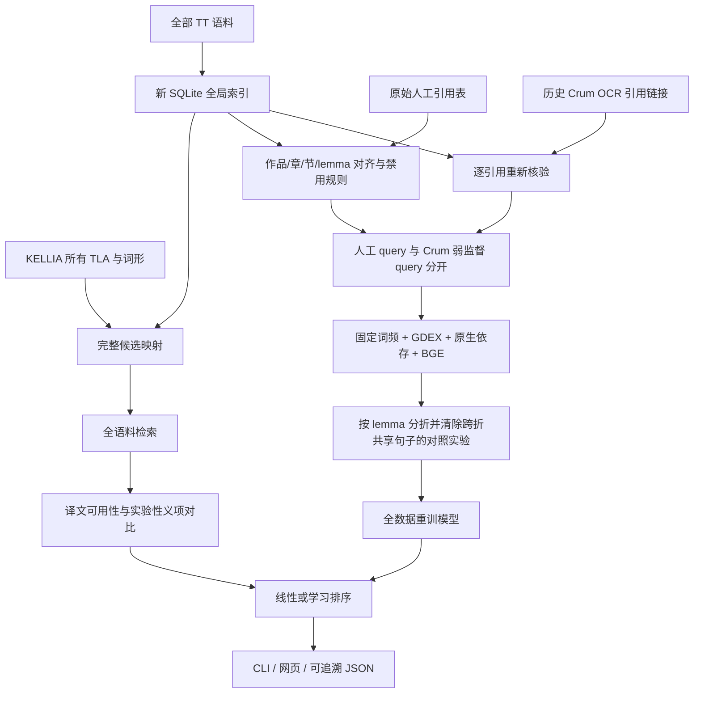

> 历史第一版说明。当前按方言分开的双模型与集合选择流程以 [PIPELINE_V2.md](PIPELINE_V2.md) 为准。

# 结构与数据流

## 确定的边界

解析单位沿用原 `get_examples` 的 verse / translation span，可能包含多句；不是语言学上已验证的一句。每条都保存 TT 路径、文献 URN、章/节、原词性、依存边、方言与来源许可。

检索不读取训练 TSV 作为候选池。`candidate` 表覆盖所有可映射 TLA 的 lemma/POS、词形变体、连续 MWE 和人工引用例外，没有 top-100 cap。搜索再排除明确禁用、空/非英语译文和重复项；默认语义评分也不截断。

义项对比过滤目前仅对实际核验过的 C992/C998 启用；它是明确的案例规则，不能宣传为对全部同形词的通用 WSD。其他词条仍会返回分项证据供复核。

## 与旧代码的关系

- 从 `dictionary/utils/get_examples.py` 学习引用边界、人工覆盖和禁用规则机制，重新实现可审计索引，避免重复执行旧脚本的数据库写入。
- 保留 Crum3 的“先抽引用、再对应语料、再训练排序”的思想；旧匹配结果只作为待核验输入，没有直接信任其句子和相似度列。
- 保留 Crum4 的“全语料检索”的目标，重新实现元数据与依存解析，消除静默 top-50/100 和占位译文问题。
- 没有复制旧在线模型。全部 38 列来自新特征协议，模型重新训练，训练/推理使用同一份固定的句面词频统计。

代码与人工规则变化后应重跑 dataset/features/train。`build --force` 重建索引后也要重跑 dataset。运行时会核对模型和索引的 corpus fingerprint；输入哈希另保存在 source manifest 中。
